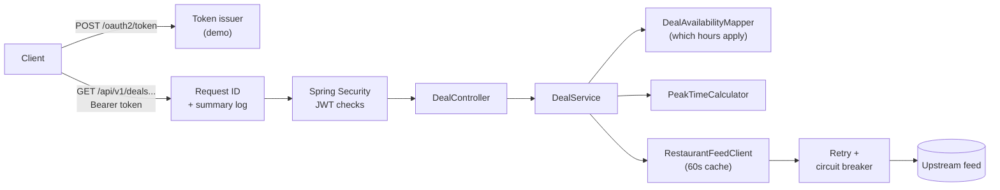

# Restaurant Deals Service

A Spring Boot REST API that reads restaurant deal data from <https://eccdn.com.au/misc/challengedata.json> and answers two questions:

- **Task 1:** which deals are active at a given time of day?
- **Task 2:** when is the peak, the time window with the most active deals?
- **Task 3:** a database design for storing the feed: PostgreSQL, with an ER diagram, notes and the schema. See [docs/database-design.md](docs/database-design.md).

**Features:** versioned REST API (`/api/v1`) · JWT bearer-token security · one consistent error format · 60s feed cache, retry and circuit breaker · health checks and metrics · request IDs in every log line · Swagger UI · 210 tests.

## Quick start

Requires **Java 21+**. No Maven install is needed: the Maven Wrapper is included.

```bash
./mvnw spring-boot:run                     # Windows: mvnw.cmd spring-boot:run
```

The service starts on `http://localhost:8080`.

> **The deals endpoints need a bearer token.** A request without one gets `401 Unauthorized`. Get a free demo token from `POST /oauth2/token` (no credentials needed), as shown below.

Get a token, then call the API:

```bash
TOKEN=$(curl -s -X POST http://localhost:8080/oauth2/token | sed -E 's/.*"access_token":"([^"]+)".*/\1/')

curl -H "Authorization: Bearer $TOKEN" "http://localhost:8080/api/v1/deals?timeOfDay=6:00pm"
curl -H "Authorization: Bearer $TOKEN" "http://localhost:8080/api/v1/deals/peak-time"
```

Or use **Swagger UI** at <http://localhost:8080/swagger-ui.html>: call `POST /oauth2/token`, click **Authorize**, paste the token, and try the endpoints. The OpenAPI spec is at <http://localhost:8080/v3/api-docs>.

## API

| Method and path | Auth | Returns |
|---|---|---|
| `GET /api/v1/deals?timeOfDay={time}` | Bearer token | The deals active at that time |
| `GET /api/v1/deals/peak-time` | Bearer token | The window with the most active deals |
| `POST /oauth2/token` | Public (demo) | A JWT access token, valid for 12 hours |
| `GET /actuator/health` (and `/liveness`, `/readiness`) | Public | Health status |
| `GET /actuator/metrics` | Bearer token | Metrics |

**`timeOfDay`** is a 12-hour time with `am`/`pm` and no space (`3:00pm`, `10:30AM`), or a 24-hour time (`15:00`). Hour and minutes are separated by `:`; leading and trailing spaces are ignored.

`GET /api/v1/deals?timeOfDay=6:00pm`:

```json
{
  "deals": [
    {
      "restaurantObjectId": "DEA567C5-F64C-3C03-FF00-E3B24909BE00",
      "restaurantName": "Masala Kitchen",
      "restaurantAddress1": "55 Walsh Street",
      "restarantSuburb": "Lower East",
      "restaurantOpen": "3:00pm",
      "restaurantClose": "9:00pm",
      "dealObjectId": "DEA567C5-0000-3C03-FF00-E3B24909BE00",
      "discount": "50",
      "dineIn": "false",
      "lightning": "true",
      "qtyLeft": "5"
    }
  ]
}
```

### Example results: 3pm, 6pm and 9pm

What `GET /api/v1/deals?timeOfDay=…` returns for the three test cases, using the live feed. A restaurant's opening time is included and its closing time is not, so a restaurant that closes at 9:00pm isn't in the 9:00pm results.

| `timeOfDay` | Deals | Restaurants (number of deals) |
|---|---|---|
| `3:00pm` | 5 | Masala Kitchen (2), ABC Chicken (2), Kekou (1) |
| `6:00pm` | 9 | Masala Kitchen (2), ABC Chicken (2), Vrindavan (1), Kekou (2), Gyoza Gyoza Melbourne Central (2) |
| `9:00pm` | 4 | ABC Chicken (2), Gyoza Gyoza Melbourne Central (2) |


`GET /api/v1/deals/peak-time` (the start is inclusive and the end exclusive):

```json
{ "peakTimeStart": "6:00pm", "peakTimeEnd": "9:00pm" }
```

Errors share one format, e.g. `{"error":{"type":"invalid_request_error","code":"invalid_time_of_day","message":"...","param":"timeOfDay"}}`. See [docs/errors.md](docs/errors.md) for every code.

**Versioning:** the version is in the path (`/api/v1`). A breaking change would be published as `/api/v2` alongside v1, so existing clients keep working while they move over. Additive changes, such as a new optional field, stay in v1.

## How it works



1. Each request gets an ID and is logged once when it finishes.
2. Spring Security checks the JWT: signature, expiry, issuer, audience and scope.
3. `DealService` gets the feed (from the cache, or upstream with retry and a circuit breaker), works out each deal's hours, and then filters by time (Task 1) or finds the peak (Task 2).

The upstream JSON models (`client/model`) are kept separate from the API's response classes (`dto`), so a change in the upstream format doesn't leak into this API's contract.

## Configuration

All settings are in `src/main/resources/application.properties`.

| Setting | Default | Purpose |
|---|---|---|
| `restaurant-feed.url` | the challenge URL | Upstream feed |
| `restaurant-feed.connect-timeout` / `read-timeout` | `2s` / `5s` | Upstream timeouts |
| `restaurant-feed.retry.*` | 3 attempts, 200ms backoff ×2 | Retry of temporary failures |
| `restaurant-feed.circuit-breaker.*` | opens at 50% of 10 calls, for 30s | Fail fast during an outage |
| `spring.cache.caffeine.spec` | `expireAfterWrite=60s` | How long the feed is cached |
| `security.jwt.*` | issuer `restaurant-deals`, audience `deals-api`, scope `deals:read`, `12h` | Token claims and lifetime |
| `security.jwt.secret` | a local-only default | Signing secret. **Set `JWT_SECRET` (32+ characters) outside local runs.** |
| `logging.level.com.eatclub.deals` | `INFO` | `DEBUG` also logs each upstream call |

Invalid values (e.g. a blank URL, a short secret, 0 retry attempts) stop the app from starting.

## Test

```bash
./mvnw test                                # Windows: mvnw.cmd test
```

The tests use a snapshot of the feed (`src/test/resources/challengedata.json`), so they don't need network access. They include a strict JSON contract test, parameterised tests for every accepted and rejected `timeOfDay`, real-HTTP tests of the feed client, and security tests for every kind of invalid token.

## Project structure

```
src/main/java/com/eatclub/deals
├── controller/     Routes and API docs (DealApi), implementation (DealController)
├── dto/            API response bodies (ActiveDealsResponse, ActiveDeal, PeakTimeResponse)
├── service/        Business logic: DealService, DealAvailabilityMapper, PeakTimeCalculator
├── client/         Upstream feed: RestaurantFeedClient (cache), FeedResilience (retry, circuit breaker), settings
│   └── model/      Shape of the feed's JSON (RestaurantFeed, Restaurant, Deal)
├── error/          Error responses: GlobalExceptionHandler, ErrorCode, ErrorType, ApiErrorResponse, ErrorDetail
├── exception/      Domain exceptions (InvalidTimeOfDayException, FeedUnavailableException, FeedCircuitOpenException)
├── security/       Token checks (SecurityConfig), JSON 401/403 (JsonSecurityErrorHandler), JWT settings (JwtConfig)
│   └── issuer/     Demo token endpoint (TokenController, TokenService, TokenResponse)
├── logging/        Request ID and per-request summary line (RequestLoggingFilter)
├── config/         OpenAPI/Swagger, the app's Clock
└── time/           Time parsing and formatting, opening-hours windows (TimeWindow)
```

## Tech stack

Java 21 · Spring Boot 4 (Web MVC, Security OAuth2 resource server, Validation, Cache, Actuator) · Caffeine · Resilience4j · springdoc-openapi · JUnit, AssertJ, Mockito.

## More documentation

| Document | Contents |
|---|---|
| [docs/database-design.md](docs/database-design.md) | **Task 3:** the database choice (PostgreSQL) and why, the ER diagram, notes, the schema (DDL) and example queries |
| [docs/business-rules.md](docs/business-rules.md) | How active deals and the peak are decided, as questions and answers (with the items to confirm with the product owner) |
| [docs/errors.md](docs/errors.md) | The error format and every error code |
| [docs/security.md](docs/security.md) | The token flow, what makes a token valid, and the demo shortcuts vs production |
| [docs/operations.md](docs/operations.md) | Feed cache, timeouts, retry and circuit breaker; health and metrics; logging |
