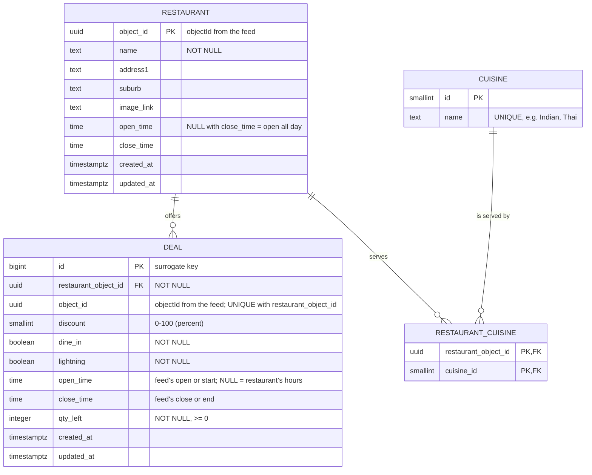

# Task 3: Database design

A schema for storing the data returned by <https://eccdn.com.au/misc/challengedata.json>.

## Database: PostgreSQL

**Why PostgreSQL:**
- **The data is relational.** Restaurants have many deals, and restaurants share cuisines. Foreign keys model this directly and keep it consistent.
- **The main questions are range queries on times:** "which deals are active at 6pm?" and "when is the peak?". PostgreSQL has a native `TIME` type and can answer these in a single query, including hours that cross midnight. A key-value store such as DynamoDB can't query "between open and close" efficiently; it would need a full scan or a hand-maintained index.
- **The schema can enforce the data rules** that the feed breaks today: real number and boolean types instead of strings, deal hours as "both or neither", `qtyLeft ≥ 0`, discounts between 0 and 100, and unique deals per restaurant.
- **It's flexible for new questions** (deals by suburb or cuisine, dine-in only, top discounts): a new query, and maybe an index, rather than a redesign.
- **It's transactional:** safe updates such as decrementing `qty_left` when a deal is redeemed.
- **It's widely supported and managed.**

DynamoDB would be the better fit for purely key-based access ("deals for restaurant X") at very large scale, or in a serverless AWS setup. That isn't this data's main access pattern.

## Diagram



## Notes

**Tables**

| Table | One row per | Notes |
|---|---|---|
| `restaurant` | Restaurant | The primary key is the feed's `objectId` (a UUID), which is unique per restaurant. |
| `deal` | Deal of a restaurant | The feed's deal IDs **aren't unique on their own**: `B5713CD0-1111-40C7-AFC3-7D46D26B00BF` belongs to both Kekou and Gyoza Gyoza, with different details. So a deal is identified by **(restaurant, deal ID)**, enforced with `UNIQUE (restaurant_object_id, object_id)`. A surrogate `id` is the primary key, so future tables (e.g. redemptions) can reference a deal with a single column. |
| `cuisine` | Cuisine name | A lookup table: each name is stored once, there are no spelling variants, and filtering by cuisine is easy. |
| `restaurant_cuisine` | (Restaurant, cuisine) pair | The many-to-many link, in place of the feed's `cuisines` array |

**How the feed maps to the schema**

| Feed field | Column | Change |
|---|---|---|
| `restaurant.objectId` | `restaurant.object_id` | Stored as `UUID` (validated, 16 bytes) |
| `open` / `close` (e.g. `"3:00pm"`) | `open_time` / `close_time` | Parsed to `TIME` (`15:00`) |
| `cuisines` (an array) | `cuisine` + `restaurant_cuisine` | Normalised |
| `deal.open`/`close` **or** `start`/`end` | `deal.open_time` / `close_time` | The feed's two spellings become one pair of columns |
| `discount` (`"50"`) | `discount SMALLINT` | String → number |
| `dineIn`, `lightning` (`"true"`) | `BOOLEAN` | String → boolean |
| `qtyLeft` (`"5"`) | `qty_left INTEGER` | String → number |

**Rules enforced by the database**
- **Deal hours are "both or neither":** `CHECK ((open_time IS NULL) = (close_time IS NULL))`. The same rule applies to restaurant hours. The partial hours that the API currently has to handle can't be stored.
- **Missing deal hours** (`NULL`) mean the deal runs for its restaurant's hours. **Equal open and close** (e.g. 15:00–15:00) mean all day. A **close earlier than open** (e.g. 18:00–02:00) crosses midnight. These are the same rules as the API's.
- `discount BETWEEN 0 AND 100`, `qty_left >= 0`; `name`, `dine_in`, `lightning` and `qty_left` are `NOT NULL`.
- **Deleting a restaurant** deletes its deals and cuisine links (`ON DELETE CASCADE`).
- **Importing:** a feed record that breaks a rule is rejected by the database. The import job logs it and skips it, the same way the API skips malformed deals today.

**Indexes**
- The primary keys and the `UNIQUE (restaurant_object_id, object_id)` constraint already index the main lookups, including all deals of a restaurant.
- `restaurant_cuisine (cuisine_id)` for "restaurants by cuisine", and `restaurant (suburb)` for "deals by suburb".

## Schema (DDL)

```sql
CREATE TABLE restaurant (
    object_id   UUID        PRIMARY KEY,
    name        TEXT        NOT NULL,
    address1    TEXT,
    suburb      TEXT,
    image_link  TEXT,
    open_time   TIME,                    -- NULL (with close_time) = open all day
    close_time  TIME,
    created_at  TIMESTAMPTZ NOT NULL DEFAULT now(),
    updated_at  TIMESTAMPTZ NOT NULL DEFAULT now(),
    CONSTRAINT restaurant_hours_both_or_neither
        CHECK ((open_time IS NULL) = (close_time IS NULL))
);

CREATE TABLE deal (
    id                   BIGINT      GENERATED ALWAYS AS IDENTITY PRIMARY KEY,
    restaurant_object_id UUID        NOT NULL REFERENCES restaurant (object_id) ON DELETE CASCADE,
    object_id            UUID        NOT NULL,           -- the feed's deal ID: unique only per restaurant
    discount             SMALLINT    NOT NULL CHECK (discount BETWEEN 0 AND 100),
    dine_in              BOOLEAN     NOT NULL,
    lightning            BOOLEAN     NOT NULL,
    open_time            TIME,                           -- NULL (with close_time) = the restaurant's hours
    close_time           TIME,
    qty_left             INTEGER     NOT NULL CHECK (qty_left >= 0),
    created_at           TIMESTAMPTZ NOT NULL DEFAULT now(),
    updated_at           TIMESTAMPTZ NOT NULL DEFAULT now(),
    CONSTRAINT deal_unique_per_restaurant UNIQUE (restaurant_object_id, object_id),
    CONSTRAINT deal_hours_both_or_neither
        CHECK ((open_time IS NULL) = (close_time IS NULL))
);

CREATE TABLE cuisine (
    id    SMALLINT GENERATED ALWAYS AS IDENTITY PRIMARY KEY,
    name  TEXT     NOT NULL UNIQUE
);

CREATE TABLE restaurant_cuisine (
    restaurant_object_id UUID     NOT NULL REFERENCES restaurant (object_id) ON DELETE CASCADE,
    cuisine_id           SMALLINT NOT NULL REFERENCES cuisine (id),
    PRIMARY KEY (restaurant_object_id, cuisine_id)
);

CREATE INDEX restaurant_cuisine_by_cuisine ON restaurant_cuisine (cuisine_id);
CREATE INDEX restaurant_by_suburb          ON restaurant (suburb);
```

## Example queries

Task 1, the deals active at 6:00pm. It uses the same rules as the API: the deal's hours, or else the restaurant's; all day when there are no hours or open equals close; and hours that can cross midnight.

```sql
CREATE FUNCTION in_window(t TIME, open_time TIME, close_time TIME) RETURNS BOOLEAN
LANGUAGE sql IMMUTABLE AS $$
    SELECT open_time IS NULL                                            -- no hours: all day
        OR open_time = close_time                                       -- equal: all day
        OR (open_time < close_time AND t >= open_time AND t < close_time)
        OR (open_time > close_time AND (t >= open_time OR t < close_time))  -- crosses midnight
$$;

SELECT r.object_id, r.name, d.object_id AS deal_object_id, d.discount, d.qty_left
FROM deal d
JOIN restaurant r ON r.object_id = d.restaurant_object_id
WHERE d.qty_left > 0
  AND in_window(TIME '18:00', r.open_time, r.close_time)
  AND in_window(TIME '18:00', COALESCE(d.open_time, r.open_time), COALESCE(d.close_time, r.close_time))
ORDER BY r.name, d.object_id;
```

Restaurants serving a cuisine:

```sql
SELECT r.name
FROM restaurant r
JOIN restaurant_cuisine rc ON rc.restaurant_object_id = r.object_id
JOIN cuisine c             ON c.id = rc.cuisine_id
WHERE c.name = 'Indian';
```
